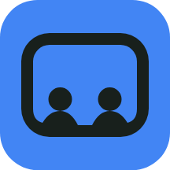
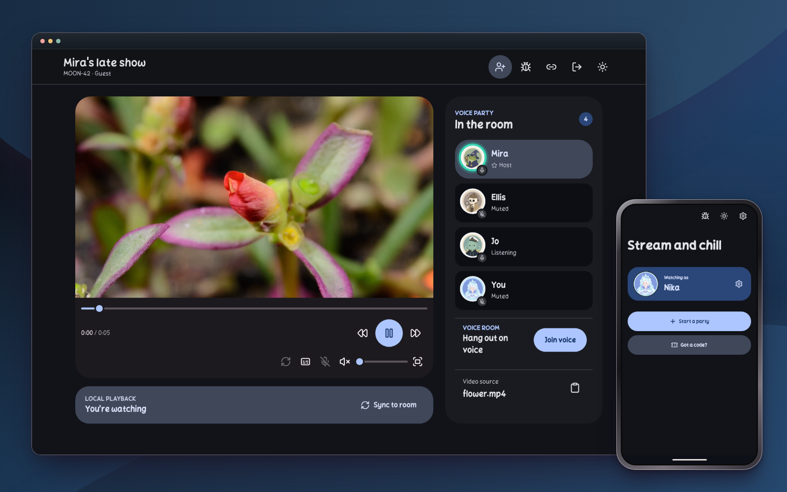
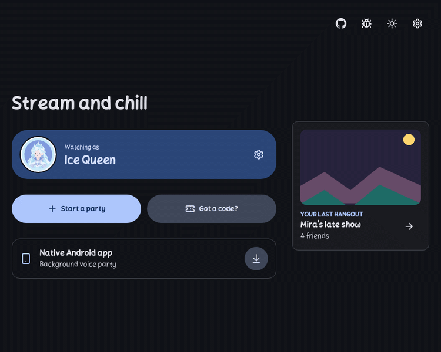
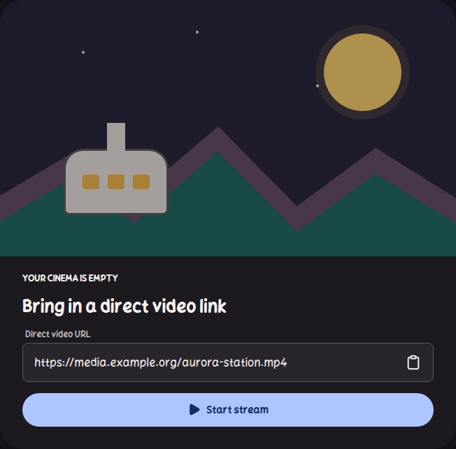
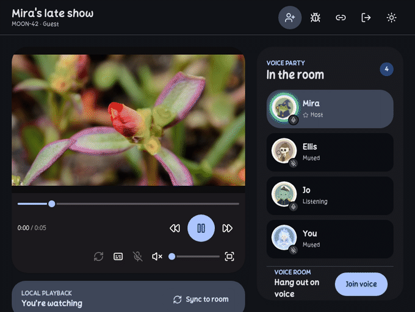
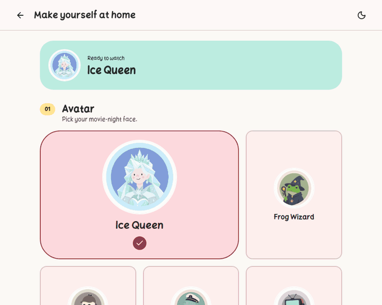
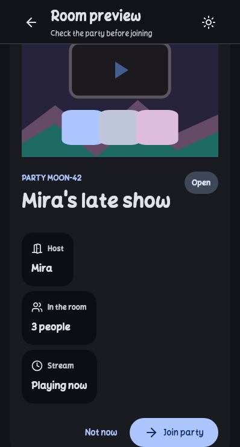
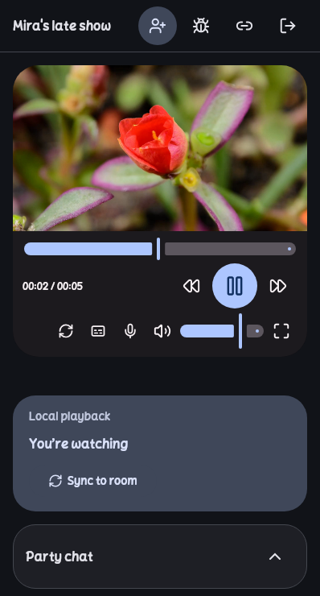

<h3 align="center">&nbsp;watchparty</h3>

<p align="center"><strong>A watch party where everyone has the remote.</strong></p>

<p align="center">Pause or rewind on your own. When you want to watch a scene together, the host can invite everyone back to the same moment. Each viewer chooses whether to join.</p>

<p align="center"><a href="https://watchparty.top"><strong>Try it on the web</strong></a> &nbsp;·&nbsp; <a href="clients/native/README.md"><strong>Build the Android client</strong></a> &nbsp;·&nbsp; <a href="LICENSE">MIT license</a></p>

<p align="center"></p>

## Inside a party

<table>
<tr>
<td width="45%"><h3>Join with a code</h3>
<p>Open an invite or enter the code a friend sends you. Before joining, see who’s hosting, how many people are there, and whether the movie has started. Your last room stays on the home screen for next time.</p></td>
<td width="55%"></td>
</tr>
<tr>
<td><h3>Bring the movie</h3>
<p>The host can paste a direct video link or pick a file. For a local movie, each viewer opens their own copy and the video stays on their device. Volume, audio tracks and subtitles are personal choices.</p>
<p><a href="docs/local-file-contract.md">How local files work →</a></p></td>
<td></td>
</tr>
<tr>
<td><h3>Sync together</h3>
<p>The host seeks to a scene and taps <strong>Ask for sync</strong>. Their player pauses, and everyone gets an invitation with the timestamp.</p>
<p>Choose <strong>Accept &amp; pause</strong> to join, or <strong>Not joining</strong> to keep watching. You can withdraw until the host starts. Once at least one guest accepts, the host can start a shared countdown for those who joined.</p></td>
<td><a href="docs/assets/readme/sync-invitation.gif"></a></td>
</tr>
<tr>
<td><h3>Pick your movie-night face</h3>
<p>Choose an illustrated avatar and friends will see its character name beside your messages. Pick a color palette, switch between light and dark, or use the app in Persian with a right-to-left layout.</p></td>
<td></td>
</tr>
</table>

**Talk over the credits.** Join voice muted and turn on your microphone when you want to speak. A speaking indicator shows who’s talking. The room also has text chat for the moments you’d rather watch quietly. [Room chat](docs/chat-contract.md)

## On Android

The native app uses the same party codes as the browser. Check the room before joining, share an invitation through the Android share sheet, and keep voice connected in the background.

<p align="center">
  
  &nbsp;
  
</p>

## Try it locally

For a walkthrough with sample guests, start the browser client with Node.js 24 and npm. From the repository root, run

```sh
cd clients/web
npm ci
npm run dev -- --host 127.0.0.1
```

Open the [local home preview](http://127.0.0.1:5173/?preview=home), choose **Got a code?**, and enter `MOON-42` to join Mira’s late show.

For a real two-person party, start the Node service and PostgreSQL using the [local backend guide](backend/local/README.md), then open the [local app](http://127.0.0.1:5173/) in two separate browser profiles. Create a room in the first and use its code in the second. Each profile gets its own guest identity automatically.

## Developing

| Component | Where to start |
| --- | --- |
| Browser | React, TypeScript and Vite. [Setup and tests](clients/web/README.md) |
| Native clients | Kotlin Multiplatform and Compose, for Android and desktop. [Build and run](clients/native/README.md) |
| Backend | Node.js, PostgreSQL, Socket.IO and Coturn for voice relay. [Local services](backend/local/README.md) |
| Shared behavior | [Product requirements](docs/requirements.md) · [Design decisions](docs/design-decisions.md) · [HTTP contracts](backend/openapi/) · [Realtime contracts](backend/asyncapi/) |

For APK signing, automatic website deployments, and manual API deployments, see the [release guide](.github/RELEASING.md).

## Special thanks

Thank you to Howard Chung and the contributors to the original [WatchParty](https://github.com/howardchung/watchparty). Their work gave this fork its starting point, and we’re grateful they shared it under the MIT License.

## License

watchparty is distributed under the [MIT License](LICENSE). The backend retains its [upstream WatchParty attribution](backend/watchparty/LICENSE).
